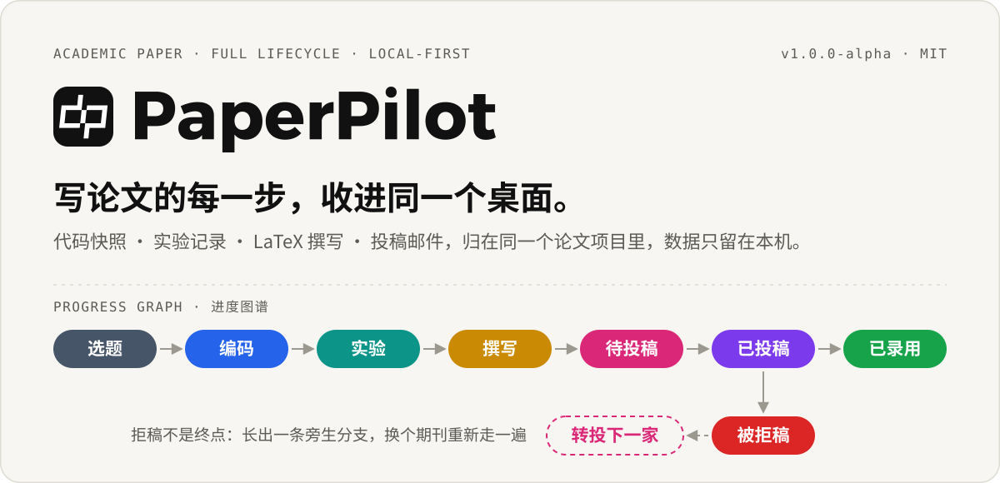
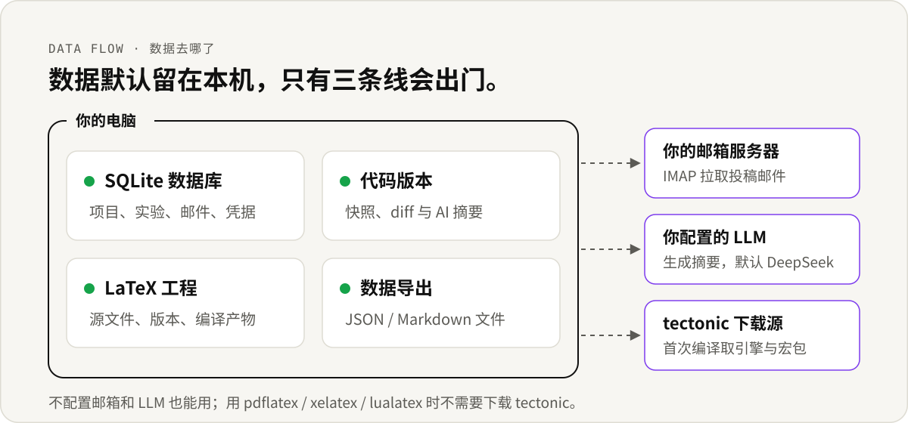

<p align="center">
  
</p>

<p align="center">
  <a href="./README_EN.md">English</a> &nbsp;·&nbsp; 简体中文
  <br /><br />
  
  
  
</p>

<!-- SHOWCASE -->

## 它解决什么

选题记在便签里，代码版本靠文件夹名区分，实验数据塞在表格里，LaTeX 在几个编辑器之间来回粘，投稿邮件淹没在收件箱。每一步都不难，难的是你成了这些工具之间的搬运工。

PaperPilot 把一篇论文从选题到录用的全过程收进一个桌面应用。每篇论文是一个项目，项目里有它自己的进度图、代码快照、实验记录、LaTeX 工程和投稿邮件。它不替你思考，只是让你不用再到处找东西。

## 一篇论文，一路走下来

| 阶段 | 用到的模块 | 它帮你做什么 |
| --- | --- | --- |
| 选题 | **项目管理** | 卡片式首页，标签整理，进行中和已归档分开放 |
| 编码 | **代码版本** | 记录每次代码快照，自动生成 diff 和 AI 摘要，按版本对比回溯 |
| 实验 | **实验记录** | 结构化登记参数、数据集、指标和笔记，表格与键值两种编辑方式 |
| 撰写 | **LaTeX 撰写** | 内置 CodeMirror 编辑器、多文件工程、版本记录和 PDF 预览 |
| 投稿 | **投稿追踪** | IMAP 拉取邮件，按论文标题筛出相关往来，AI 归类并摘要审稿意见 |
| 全程 | **进度图谱 · 数据导出** | 一张图看清论文走到哪一步，拒稿可转投；一键导出全部数据备份 |

## 数据去哪了

<p align="center">
  
</p>

- 所有数据存在本地 SQLite 数据库里，不上传到任何 PaperPilot 服务器。
- 邮件通过 IMAP 直接从你的邮箱服务器拉取，凭据只存在本地数据库。
- LLM 请求从你的设备直接发给你配置的服务商（OpenAI 兼容接口，默认 DeepSeek）。

## 快速开始

需要 Node.js ≥ 18、npm ≥ 9，Windows / macOS / Linux 均可。

```bash
npm install          # 会自动编译 better-sqlite3 等原生模块
npm run dev          # 启动桌面应用
npm run seed:demo    # 可选：写入 5 个演示项目，体验完整流程
```

演示数据覆盖已录用、拒稿转投、待返修、实验中、选题中五种状态，并附带代码版本、实验记录、邮件和 LaTeX 工程文件。

开发模式下 LLM 配置以空 API Key 初始化。想预填 DeepSeek Key，可以在启动前设置环境变量：

```bash
DEEPSEEK_API_KEY=your-key-here npm run dev                  # bash / zsh
$env:DEEPSEEK_API_KEY = "your-key-here"; npm run dev        # PowerShell
```

生产构建永远不会打包 API Key，用户需要在「设置 → LLM 配置」里自己填写。

<details>
<summary><b>构建与打包</b></summary>

```bash
npm run build        # 编译主进程 + 渲染进程

npm run dist:win     # Windows x64 + arm64
npm run dist:mac     # macOS x64 + arm64
npm run dist:linux   # Linux x64 + arm64
```

</details>

## LaTeX 引擎

| 引擎 | 类型 | 说明 |
| --- | --- | --- |
| **tectonic** | 内置 | 默认引擎，无需额外安装，首次使用自动下载 |
| **pdflatex** | 系统 | 需要本地 TeX 发行版（TeX Live / MiKTeX） |
| **xelatex** | 系统 | 支持中文，需要本地 TeX 发行版 |
| **lualatex** | 系统 | 需要本地 TeX 发行版 |

系统引擎会编译 3 次以处理交叉引用，输出到 `.build/` 子目录。在「设置 → LaTeX 引擎」里切换。

<details>
<summary><b>技术栈</b></summary>

- **运行时**：Electron 33 + Vite 6 + React 19 + TypeScript 5.7
- **UI**：[@lobehub/ui](https://github.com/lobeHub/lobe-ui) + Ant Design 6 + lucide-react
- **动画**：[motion](https://github.com/motiondivision/motion)（spring 物理动画）
- **数据库**：better-sqlite3（本地优先，数据不出设备）
- **AI**：LangChain + OpenAI 兼容接口（默认 DeepSeek）
- **邮件**：imapflow + mailparser
- **图表**：@xyflow/react（进度节点图）
- **编辑器**：CodeMirror 5（LaTeX 语法高亮）
- **状态**：Zustand + React Router 7

</details>

<details>
<summary><b>项目结构</b></summary>

```
PaperPilot/
├── electron/              # Electron 主进程
│   ├── index.ts           # 主进程入口
│   ├── preload.ts         # 预加载脚本（IPC 桥）
│   └── ipc/               # IPC 处理器（db/email/git/latex/llm/window）
├── src/                   # 渲染进程（React）
│   ├── components/        # 布局与共享组件
│   ├── modules/           # 功能模块（按领域划分）
│   │   ├── project-list/  # 首页项目列表
│   │   ├── dashboard/     # 项目详情与进度图谱
│   │   ├── code-manager/  # 代码版本管理
│   │   ├── experiment-manager/  # 实验记录
│   │   ├── latex-editor/  # LaTeX 编辑器
│   │   ├── submission-manager/  # 投稿与邮件追踪
│   │   ├── data-export/   # 数据导出
│   │   ├── settings/      # 设置中心
│   │   ├── archive/       # 归档
│   │   └── about/         # 关于
│   ├── stores/            # Zustand 状态
│   ├── lib/               # 工具与配置
│   └── assets/            # 静态资源
├── database/              # 数据库 schema 与访问层
├── shared/                # 主进程/渲染进程共享类型
├── scripts/               # 构建、图标、种子数据脚本
├── resources/             # 应用图标
└── electron-builder.json  # 打包配置
```

</details>

## 参与

目前处于 alpha 阶段，部分接口还会调整。欢迎提 Issue 和 Pull Request，架构上的取舍记录在 [DECISIONS.md](./DECISIONS.md)。

## 许可证

[MIT License](./LICENSE) © 2026 ZhanYiHui06
